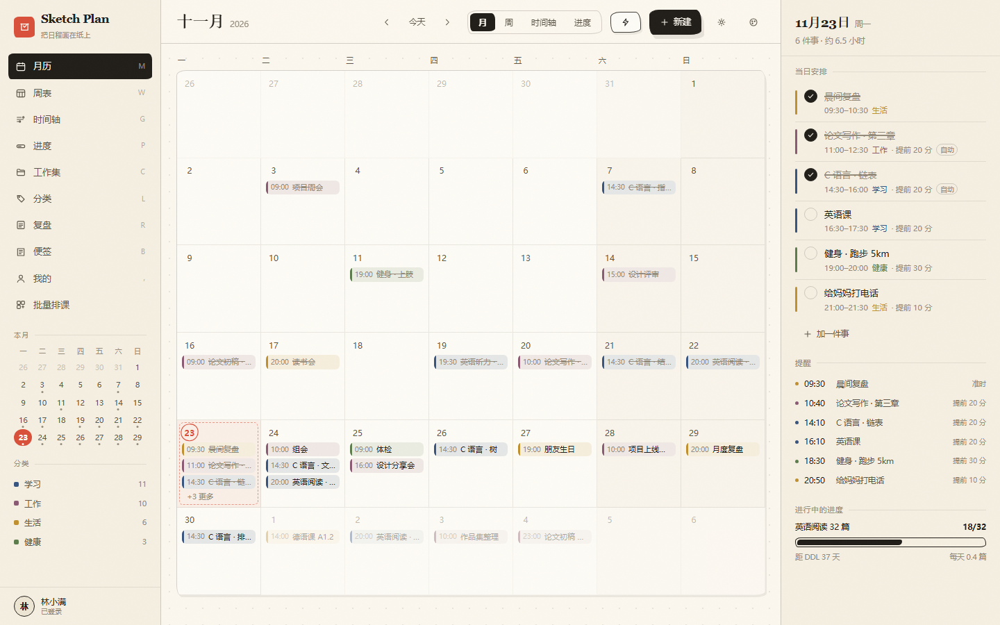
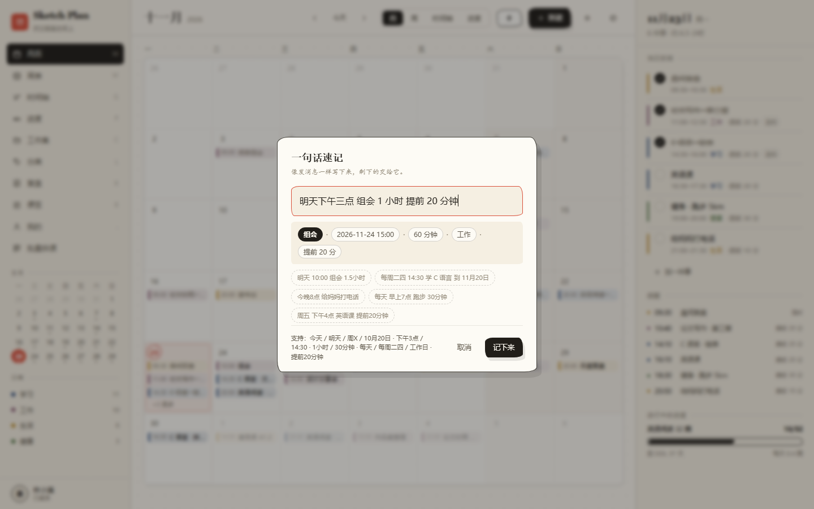
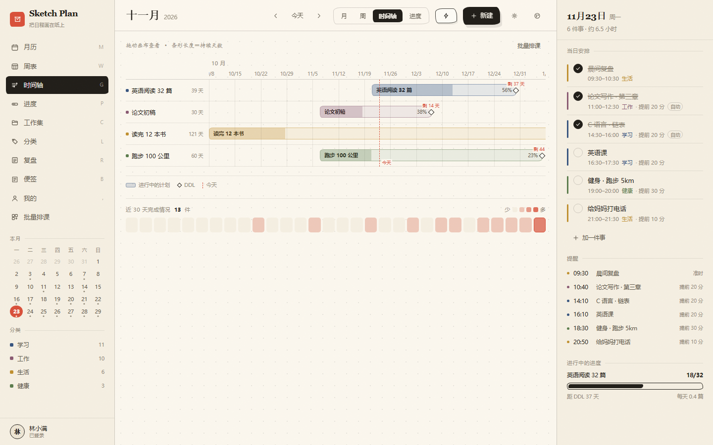
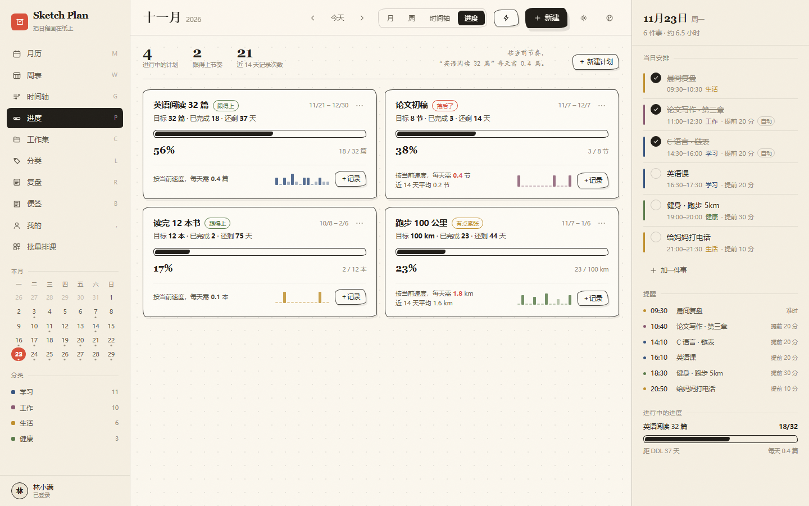
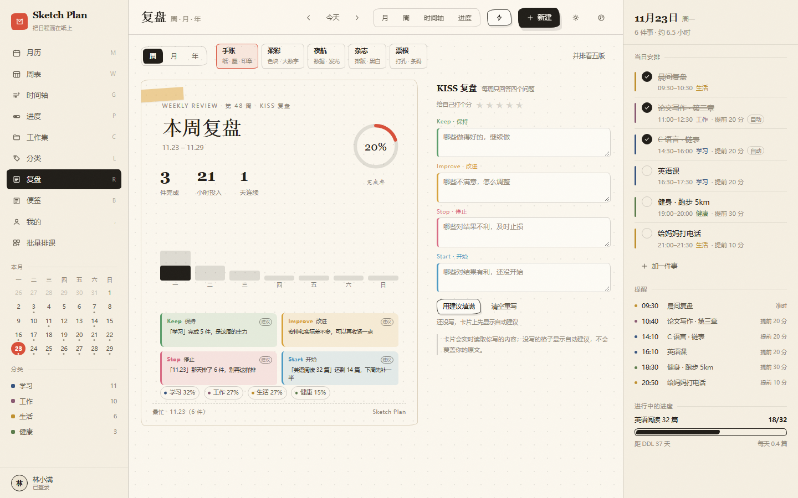
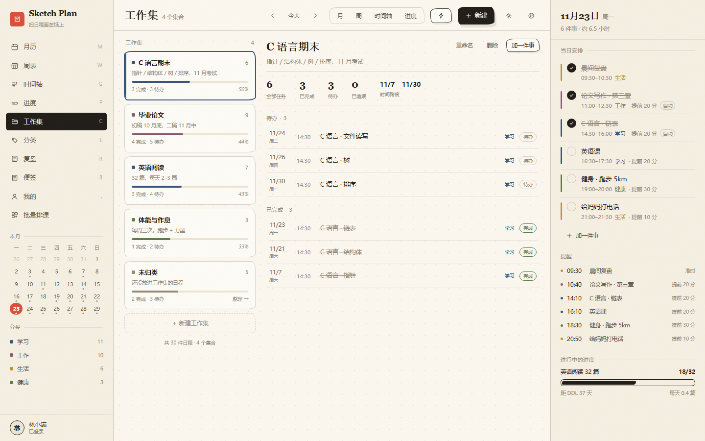

# Sketch Plan · 手账日程

> **把日程"画"在纸上。** 一个以「纸墨」为视觉语言的个人日程管理 + 长期进度追踪工具。
> 原生 Web 应用（PWA）+ 微信小程序，零构建、零框架、零依赖，开箱即用。

<p align="center">
  
  
  
  
  
  
</p>

---

## 一句话

像一本被认真使用过的纸质手账：米白的纸、微微洇开的墨、贴着胶带的便签。用**一句话速记**（"明天下午三点 组会 1 小时 提前 20 分钟"）低成本记日程，在**月历 / 周表 / 时间轴 / 进度**四个视图里看同一份数据，用**工作集**和**复盘**把「记录 → 查看 → 完成 → 复盘」串成闭环。

## ✨ 核心特性

- **📝 一句话速记** — 中文自然语言解析日期、时间、时长、重复、提醒、分类，输入即预览，解析错了立刻能改。
- **🗓 四个视图，一份数据** — 月历、周表、时间轴（类甘特）、进度，全部是同一份数据源的投影，切换无延迟、无口径不一致。
- **🎨 三套主题** — 纸墨 Ink Paper（米白 + 朱红 `#D9503A`）、柔彩 Pebble（白底 + 靛蓝 `#5B6CFF`）、夜航 Aurora（深底 + 紫青渐变）。组件只消费 CSS 变量，切换主题不跳动、不换 DOM。
- **🔁 重复日程 + 批量排课** — RRULE 式重复规则，支持每天 / 工作日 / 每周几 / 到某日；批量排课一次为多天安排同一事件，长期排期不截断（上限 730 天）。
- **📚 工作集（Collections）** — 跨时间的任务容器，把「一个项目 / 一个阶段」的日程归到一起看进度。
- **📈 长期计划 + 打卡** — 目标值 + 单位 + 每日记录，进度 = `sum(logs)` 实时重算，带节奏诊断（on track / at risk / behind）。
- **🔄 复盘** — 周 / 月 / 年复盘，五种视觉风格（手账 / 柔彩 / 夜航 / 杂志 / 票根）共用同一份统计，四格方法论（KISS / GRAI / 年度四问）。
- **📱 双端 + 小程序** — 桌面三栏 / 平板两栏 / 手机底部 Tab 响应式；另有原生微信小程序版（本地存储）。
- **⚡ 无构建、零依赖** — 双击 `index.html` 即跑（纯前端 localStorage 模式），`node server/index.mjs` 起完整后端（`node:sqlite` 内置，无需装任何 npm 包）。

## 📸 界面预览

以下截图使用应用内置的演示数据。

| 月历 | 一句话速记 | 时间轴 |
|:---:|:---:|:---:|
|  |  |  |

| 进度 | 复盘 | 工作集 |
|:---:|:---:|:---:|
|  |  |  |

## 🧱 技术栈

| 层 | 选型 | 说明 |
|---|---|---|
| 前端 | **原生 JavaScript**（`assets/*.js`） | 无框架、无打包器，直接 `index.html` 加载 |
| 样式 | **CSS 变量设计令牌**（`assets/app.css`） | 三主题 = 三组 token，组件只消费变量名 |
| 后端 | **Node.js 22**（`server/*.mjs`，原生 `http`） | 零依赖，用内置 `node:sqlite` |
| 数据库 | **SQLite**（`data/sketchplan.db`） | 单文件，自动建表 + 幂等迁移 |
| 部署 | **Docker Compose + Caddy** | Caddy 自动 HTTPS，`app` + `caddy` 两个服务 |
| 小程序 | **原生微信小程序**（`miniprogram/`） | 个人主体，`wx.storage` 本地存储 |

> 架构哲学：**一份数据模型，三套皮肤，双端各自优化。** 不做"每套主题复制一份界面"的维护噩梦，也不做"移动端是桌面缩小的结果"。

## 🚀 快速开始

### 纯前端（零依赖，30 秒）

```bash
# 直接双击 index.html，或
python -m http.server 8000
# → http://localhost:8000   （数据存 localStorage，未登录走演示库）
```

### 完整后端（账号 + 同步 + 提醒）

```bash
node server/index.mjs
# → http://localhost:4310   （静态站 + /api，首次启动自动建表 data/sketchplan.db）
```

> 需要 **Node.js ≥ 22**（用到 `node:sqlite`）。

### Docker 部署（生产）

```bash
cp .env.example .env        # 改 DOMAIN=你的域名
docker compose up -d --build
# → https://你的域名   （Caddy 自动申请证书）
```

接口冒烟测试（29 项：注册 / 登录 / 日程 / 重复 / 顺延 / 批量 / 任务 / 复盘 / 权限）：

```bash
node server/index.mjs &     # 另起终端
node server/test.mjs
```

## 🏗 架构与目录

```
sketch-plan/
├── index.html            # 应用入口（桌面 + 平板 + 手机同一入口）
├── auth.html             # 登录 / 注册页
├── preview.html          # 评审页：三主题缩略 + 手机/平板机模
├── manifest.webmanifest  # PWA 清单
├── assets/               # 前端（无构建）
│   ├── app.css           #   设计系统：token、三主题、组件、断点
│   ├── app.js            #   渲染与交互
│   ├── store.js          #   数据层（localStorage / 内存）
│   ├── sync.js           #   服务端同步（乐观更新 + 回滚）
│   ├── parse.js          #   一句话速记的解析规则
│   ├── review.js/.css    #   复盘卡（五种风格）
│   └── boot.js/.css      #   登录载入过渡动效
├── server/               # 后端（Node 22 零依赖）
│   ├── index.mjs         #   HTTP 服务 + 路由 + /api
│   ├── db.mjs            #   SQLite 建表 + 幂等迁移
│   ├── auth.mjs          #   会话 + 密码（哈希）
│   ├── recurrence.mjs    #   重复规则展开（RRULE）
│   ├── users.mjs         #   账号 CLI 管理
│   ├── worker.mjs        #   提醒扫描
│   ├── backup.mjs        #   每日备份
│   └── test.mjs          #   29 项接口冒烟测试
├── miniprogram/          # 微信小程序（原生，本地存储）
├── docs/                 # 文档与截图
│   ├── screenshots/      #   界面截图
│   └── PRODUCT-INTRO.md  #   产品详情介绍
├── DESIGN-SYSTEM.md      # 设计系统与双端规范（三主题 token 全表）
├── CHANGELOG.md          # 更新记录（v1.6.2 → v1.9.0）
├── OPS.md                # 运维手册
├── GO-LIVE.md            # 上线清单
├── MINIPROGRAM.md        # 小程序开发说明
├── Dockerfile            # 多阶段构建
├── docker-compose.yml    # app + caddy
└── Caddyfile             # 反向代理 + HTTPS
```

## 🎨 设计系统

三套主题共用同一网格与组件尺寸，只通过 CSS 变量切换「填充、描边、圆角、阴影、字体、局部装饰」六类属性。

| | **Ink Paper 纸墨** | **Pebble 柔彩** | **Aurora 夜航** |
|---|---|---|---|
| 底色 | 米白 `#FBF7EE` | 近白 `#FBFBFD` | 近黑 `#0A0B0F` |
| 主色 | 朱红 `#D9503A` | 靛蓝 `#5B6CFF` | 紫青渐变 `#8B5CF6→#22D3EE` |
| 圆角 | 不对称 14/8/16/6 | 大而均匀 18/26 | 克制 8/12 |
| 阴影 | 硬投影 `2px 3px 0` | 柔光 | 1px 描边 + 发光 |

> 完整 token 对照、组件规范、动效规范见 [DESIGN-SYSTEM.md](DESIGN-SYSTEM.md)。

## 🗺 路线图

- [x] 一句话速记、四视图、三主题、重复 + 批量排课
- [x] 工作集、长期计划 + 打卡、周/月/年复盘
- [x] 账号 + 多设备同步 + 提醒（站内）
- [x] PWA + 微信小程序
- [ ] 接入 AI：让「一句话速记」打破固定规则约束，更灵活地理解自然语言（规则保留作兜底）
- [ ] 跨时区 / 夏令时的 UTC 换算（当前按墙钟存储）
- [ ] Web Push + 邮件渠道（邮件已于 v1.7.0 移除，Push 待接）

## 📄 许可证

[MIT](LICENSE) · © Limmie

---

*更多背景：产品理念见 [产品介绍](docs/PRODUCT-INTRO.md)，开发任务书见 [历史任务书](SketchPlan-CLAUDE.md)（历史理想态文档，实际落地为原生 JS + SQLite 轻量路线，二者技术选型不同，以本 README 与 `AGENTS.md` 为准）。*
